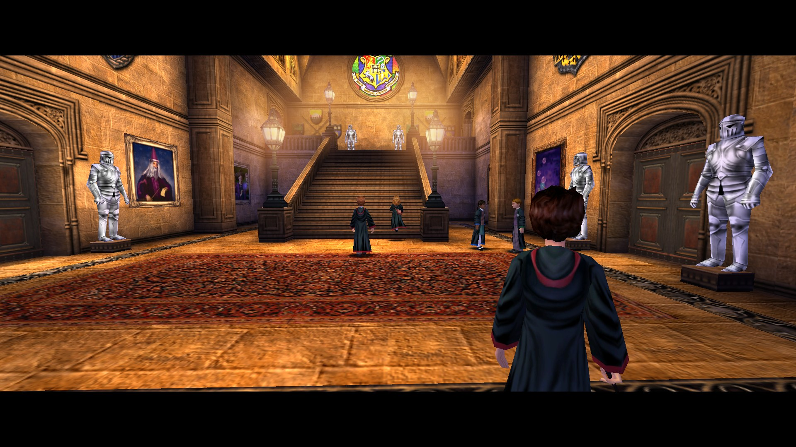
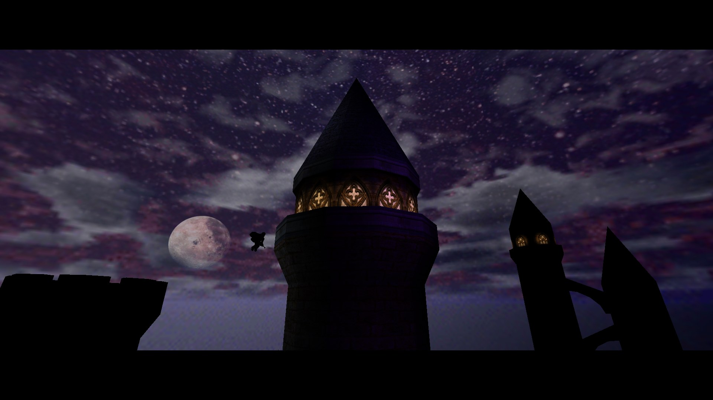
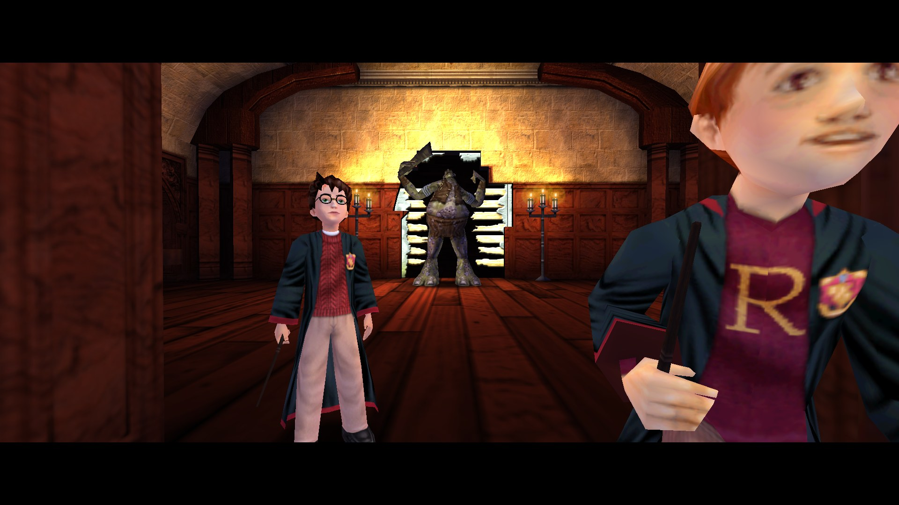
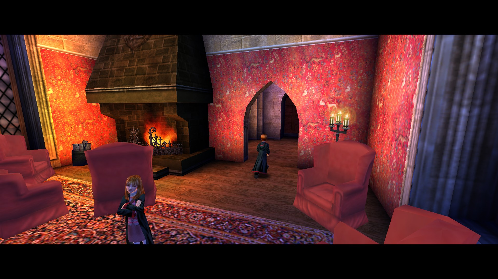
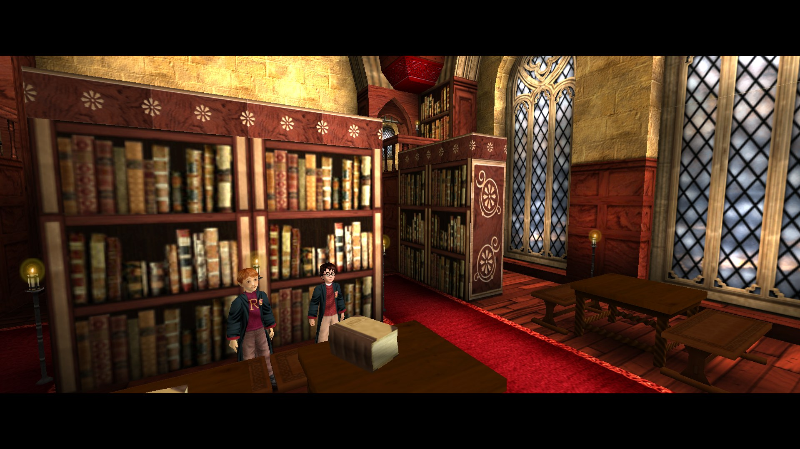
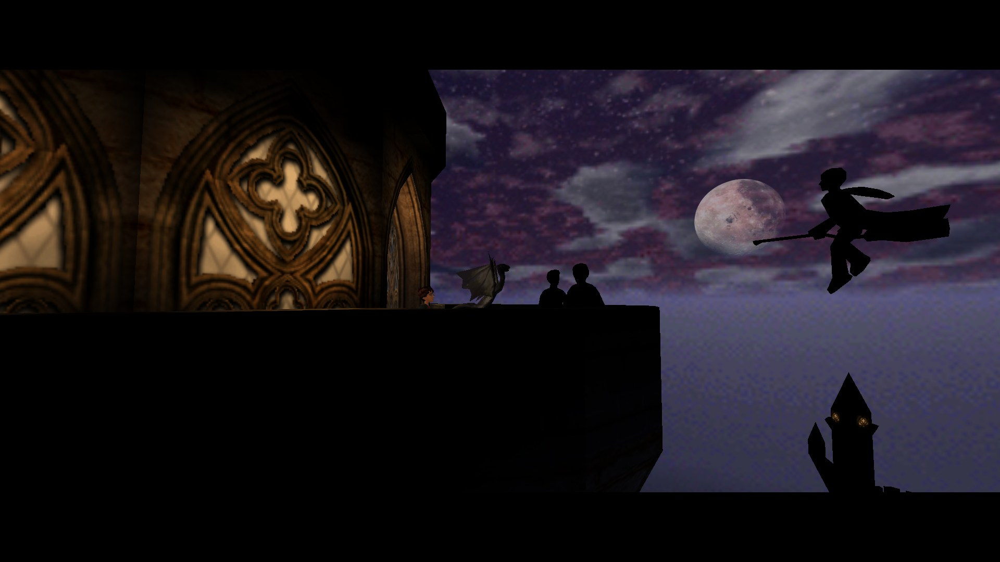
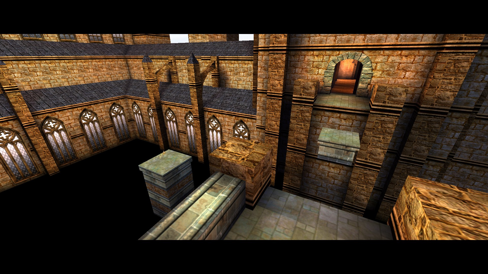
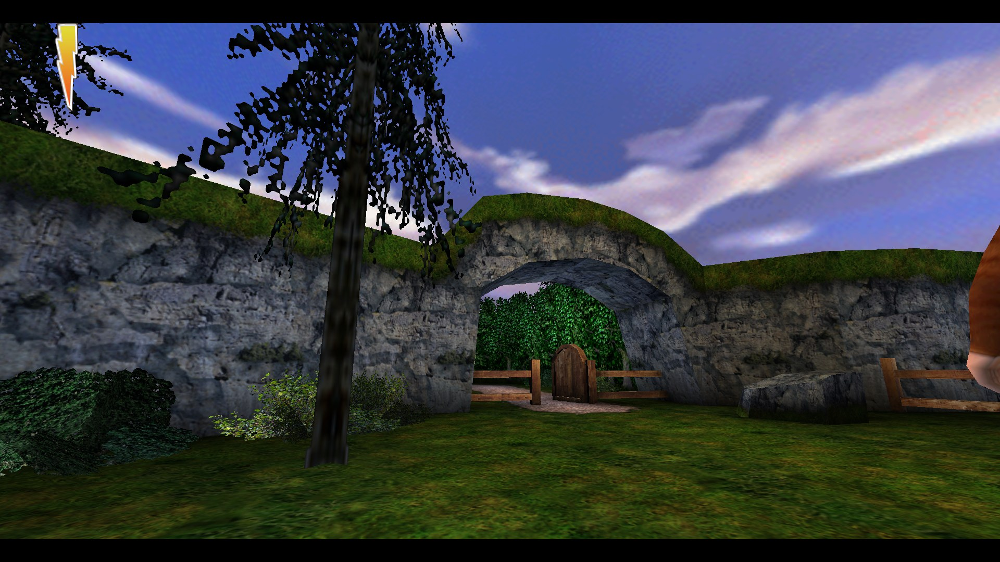
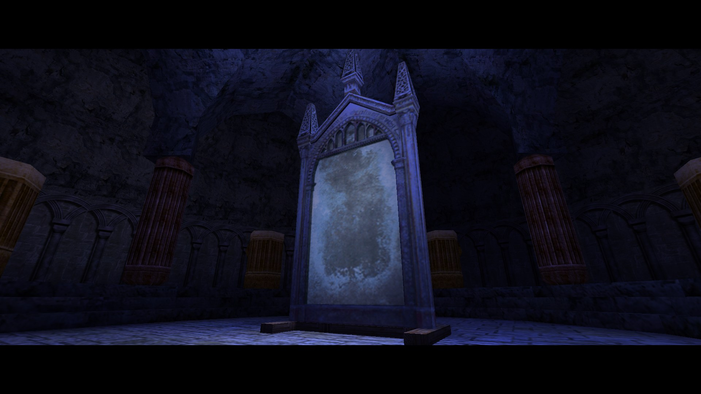

# HPEngine (OpenHP1)

<p align="center">
  <a href="../../releases"></a>
  <a href="LICENSE"></a>
  
</p>

<p align="center">
  <b>A native engine for the 2001 PC game Harry Potter and the Sorcerer's Stone.<br>
  macOS, Windows and Linux. The original game, checked against the original.</b>
</p>

<p align="center">
  
</p>

HPEngine is an unofficial, open-source replacement for the engine behind **Harry Potter and the Philosopher's Stone /
Sorcerer's Stone** for PC (KnowWonder / Electronic Arts, 2001; Unreal Engine 1). It contains nothing of the game: it
reads the maps, UnrealScript code, textures, sounds and music from a copy you own and runs them on new code.

**A legally obtained copy of the game is required.** See [Requirements](#requirements).

Until version 0.2.0 this project was called OpenHP1. It is not related to
[SplittyDev/openhp1](https://github.com/SplittyDev/openhp1), a project in Rust with that name.

Status: **beta (0.2.0)**. Only Harry Potter 1 is playable; Harry Potter 2 is planned. The full campaign was completed
on 0.1.0. Coming from 0.1.0? See [CHANGELOG.md](CHANGELOG.md) for how to move your saves.

## Quick start

1. **Download** the package for your system from [Releases](../../releases):
   - macOS (Apple Silicon and Intel): `HPEngine-Launcher-macOS.zip`
   - Windows: `HPEngine-win-x64.zip`
   - Linux / Steam Deck: `HPEngine-linux-x64.tar.gz`
2. **Add your game.** Start the launcher (macOS: HPEngine Launcher; Windows: `HPEngine Launcher.exe`; Linux: `HPEngine-Launcher`)
   and add the game. It accepts the CD, the game's installer or an installed game folder (and, on macOS, a disc image),
   and never changes your files.
3. **Play.** Press **Play** in the launcher.

Step by step, with the first-launch warnings of macOS and Windows: [Install](#install).

## Contents

- [Highlights](#highlights) · [Improvements](#improvements-over-the-2001-release) · [Requirements](#requirements) · [Install](#install) · [Mods](#mods)
- [Known issues](#known-issues) · [Reporting a bug](#reporting-a-bug) · [FAQ](#faq) · [Contact](#contact) · [License](#license) · [Legal](#legal)
- More: [all differences from the original](docs/differences.md) · [settings](docs/settings.md) ·
  [building from source](docs/building.md) · [how the original engine works](docs/README.md) ·
  [code architecture](docs/architecture.md) · [contributing](docs/contributing.md)

## Highlights

- **Native, without a compatibility layer.** Built for Apple Silicon and Intel Macs, Windows x64 and Linux x64; no Wine, no
  virtual machine. The CD check and SafeDisc protection of the 2001 release are not involved, so modern Windows
  versions that refuse SafeDisc are no obstacle.
- **The game's own code, unchanged.** The shipped UnrealScript bytecode runs as it is in HPEngine's virtual machine; the
  engine's native functions are ported from the original binaries. Game logic, physics, timing, animation and saves
  behave as in 2001.
- **Measured against the original.** Ported functions are run side by side with the original machine code in an
  emulator, frames are compared draw call by draw call with the running original game, and whole levels are played in
  both and their state compared. Every difference found so far has been fixed; please report any you notice.
- **Modern displays.** Any resolution and aspect ratio: on a wide screen you see more to the sides, the interface is
  scaled by whole pixels, and fast displays get up to 120 interpolated frames per second while the game logic keeps
  its native 60 Hz.
- **Easy setup.** A launcher on macOS, Windows and Linux installs the game from the CD, the game's installer or an
  already installed folder (on macOS also from a disc image), switches mods on and off and starts the game. On macOS
  it also keeps itself up to date.

<table>
  <tr>
    <td></td>
    <td></td>
  </tr>
  <tr>
    <td></td>
    <td></td>
  </tr>
  <tr>
    <td></td>
    <td></td>
  </tr>
  <tr>
    <td></td>
    <td></td>
  </tr>
</table>
<p align="center"><sub>HPEngine at 1920x1080 with the US 1.53 game files.</sub></p>

## Improvements over the 2001 release

The game itself is left as it was. Where HPEngine deliberately does something differently, it is listed here and in
detail, marked "not original", under [Differences from the original](docs/differences.md):

- **Picture:** wide-screen view without stretching (menus and 2D screens stay 4:3), sharp interface at every size,
  smooth motion up to 120 fps, 16x anisotropic and trilinear filtering, models at full detail at any distance, no dark
  band on glasses, light flares hidden behind Harry instead of shining through him.
- **Timing:** the game logic is locked to 60 Hz, as its scripts assume; it never runs fast on high-refresh displays,
  and torch flames do not stop above 128 fps as they do in the original.
- **Sound:** mixed at 44.1 kHz instead of 22 kHz; music continues from the same place after Alt-Tab or the pause menu
  and songs are no longer cut short; lowering the sound volume no longer silences the music.
- **Menus and input:** mouse-wheel scrolling in lists, an open list closes when the page changes, every resolution
  offered in every window mode, readable key names, the mouse is captured in a window without an extra click; gamepad
  support, with the controller's own button names on the Controls page and the d-pad stepping between menu controls,
  sliders and list items.
- **Bugs of the original fixed:** some Bertie Bott's beans flew away from Harry at a steady frame rate; Mrs Norris
  could not climb the library bookcases above about 30 fps.
- **Saves:** HPEngine's own save files stay loadable across HPEngine versions.

What we learned about how the original engine works, with addresses in the original binaries: [docs/](docs/README.md).

## Requirements

- Your copy of the PC game, one of:

| edition | support |
|---|---|
| US English 1.53 | **exact**: the reference the port is checked against |
| UK English 1.1 | supported: plays through, not yet proven exact |
| Russian (EA) | supported: plays through, not yet proven exact; menu text in a substitute font (Liberation Sans for MS Sans Serif, **not original**) |
| any other unmodified release (European English, French, German, Spanish, Italian, ...) | **unverified**: installed and run with a warning; it may not work correctly |
| the fan "1.55" patch, modded re-releases (such as the 2002 "City" disc), other modified copies | **modified**: installed and run with a warning; the port is not checked against changed game scripts |

  HP1Setup detects the edition from the files and shows it. For a release it does not recognise it shows a warning
  with the SHA-1 hashes of `System/HP.exe`, `Engine.dll`, `Render.dll` and `HPBase.u` (HPEngine prints the same warning
  at start): please [open an issue](https://github.com/artemnikonov/hpengine/issues) with them and say whether the
  game works.
- One of:

| platform | status |
|---|---|
| macOS, Apple Silicon (M1 or later) | developed and played on; the package is not signed or notarized |
| macOS, Intel | the Launcher is universal; tested under Rosetta on Apple Silicon, **not yet on an Intel Mac** |
| Windows x64 (D3D12) | installs, plays, saves and loads under CrossOver (D3D12 translated); **not verified on a Windows PC yet** |
| Linux x64 / Steam Deck (Vulkan) | runs natively on the Steam Deck (no Proton); a full playthrough there is still to do |

## Install

You need your own copy of the game: the CD, the game's installer, or an installed game folder (see
[Requirements](#requirements)). HPEngine never changes it: it only reads it and copies the game data into a folder of
its own.

Pick your system. The launcher is the easy way; the last two ways are for people who prefer the terminal.

### macOS (Apple Silicon and Intel)

1. Download `HPEngine-Launcher-macOS.zip` from [Releases](../../releases) and unpack it.
2. Move **HPEngine Launcher** to Applications and open it. It is not signed by Apple, so the first time macOS blocks
   it: open **System Settings → Privacy & Security** and click **Open Anyway**
   (or run `xattr -dr com.apple.quarantine "/Applications/HPEngine Launcher.app"`).
3. Drop your copy of the game onto the launcher window (or click **Choose…**), click **Install**, then **Play**.
   It takes an installed game folder, the CD or a disc image, the game's installer, or a `.zip` of the game folder.

The launcher keeps itself up to date and only installs updates signed by HPEngine. (The 0.1.0 "OpenHP1 Launcher"
does not update to HPEngine: download this one once.)

### Windows

1. Download `HPEngine-win-x64.zip` from [Releases](../../releases) and unpack it into an **empty folder**. Inside are
   `HPEngine Launcher.exe`, `README.txt` and the folder `HPEngine\`; keep them together. No admin rights needed.
2. Run `HPEngine Launcher.exe`. The files are not signed: if SmartScreen warns, choose **More info → Run anyway**.
3. Add your game with **Add folder…** (an installed game, or the CD drive) or **Add file…** (the game's `Setup.exe`
   or a `.zip`), click **Install**, then **Play**. A disc image: double-click it to mount it, then add the new drive.

### Linux / Steam Deck

1. Download `HPEngine-linux-x64.tar.gz` from [Releases](../../releases) and unpack it into an empty folder
   (`tar -xzf HPEngine-linux-x64.tar.gz`, or **Extract** in the file manager). Inside are `HPEngine-Launcher`,
   `README.txt` and the folder `HPEngine/`; keep them together.
2. Run `HPEngine-Launcher` (double-click; if the file manager asks, choose **Execute**, or allow running it in the
   file's properties). Needs a Vulkan driver.
3. Add your game with **Add folder…** or **Add file…**, click **Install**, then **Play**. A disc image: mount it
   first (Steam Deck: right-click in Dolphin → **Mount**), then add the mounted folder.

Steam Deck: in Desktop Mode, Steam → **Add a Game → Add a Non-Steam Game…** → browse to `HPEngine-Launcher`, and
start it from the Steam library (in Game Mode, and in Desktop Mode too). Started from Steam, the Deck's controls work
as a gamepad; started from a desktop shortcut, Steam keeps its desktop layout (trackpad as mouse, triggers as clicks)
until you hold the **≡** (Options) button.

To update on Windows and Linux, download the new archive and unpack it over the old one: the game data, saves and
settings are in your user folder and stay. The launcher tells you when a new version is out.

### Without the launcher (Windows, Linux)

From the unpacked folder, in a terminal:

```sh
HPEngine/HP1Setup <game folder, CD, installer or .zip>   # checks the copy, copies the data into HPEngine/game/
HPEngine/HPEngine                                        # plays
```

(Windows: `HPEngine\HP1Setup.exe`, `HPEngine\HPEngine.exe`.) A game installer (Inno Setup `Setup.exe` with its `.bin`
files, or InstallShield `data1.cab`) is unpacked, never run. HP1Setup prints the edition it found and refuses to write
into a folder that holds a game it did not install.

### Manually, into your game folder (all systems)

If you already have the game installed (or its installed folder copied from a Windows PC), HPEngine can run it in
place. The **game folder** is the one with `System/` and `Maps/`.

1. Download the archive for your system from [Releases](../../releases): `HPEngine-win-x64.zip`,
   `HPEngine-linux-x64.tar.gz`, or for macOS `HPEngine-osx-arm64.tar.gz` (Intel Mac: `HPEngine-osx-x64.tar.gz`).
2. Unpack it **into the game folder**. Nothing in it overwrites a game file.
3. Run it:
   - Windows: `HPEngine Launcher.exe` (unpacked into a game folder it works with that game: nothing is installed and
     it never removes your folder), or `HPEngine\HPEngine.exe` directly.
   - Linux / Steam Deck: `./HPEngine-Launcher`, or `./HPEngine/HPEngine`. On a case-sensitive file system keep the
     original file names exactly (`System`, `Maps`, `Lev_Tut1.unr`, ...).
   - macOS: this archive has no launcher and no wrapper folder: `tar -C <game folder> -xzf HPEngine-osx-arm64.tar.gz`,
     then `xattr -dr com.apple.quarantine <game folder>` and run `./HPEngine` from Terminal.

The engine also takes the game folder as `--root <game folder>`. If the game is not found, HPEngine shows what is
missing and exits with code 4.

### Where things are

| | macOS | Windows | Linux / Steam Deck |
|---|---|---|---|
| game folder (launcher) | `~/Library/Application Support/HPEngine/game` | `%LOCALAPPDATA%\HPEngine\game` | `~/.local/share/HPEngine/game` |
| saves | `<game folder>/Save/` | same | same |
| settings and logs | `<game folder>/HPEngineData/` (logs in `logs/`) | same | same |
| mods | `<game folder>/Mods/` | same | same |

Without the launcher the game folder is `HPEngine/game/` (HP1Setup) or your own game folder (manual install). The
launcher's **More** menu opens the saves and the logs. The shipped `.ini` files are never rewritten. Saves are in
HPEngine's own format: they stay loadable across HPEngine versions, but saves of the original game are not read.

## Controls and settings

Keyboard and mouse work as in the original (rebind keys in **Options → Controls**); **Alt+Enter** toggles fullscreen.
A gamepad works out of the box (not original): left stick moves, right stick looks, A jumps, X or the right trigger
casts, B skips, Start opens the book; **Options → Controls** shows and rebinds the gamepad's buttons while you use it.
The full layout, interface size, the original-look mode and the other HPEngine settings:
[docs/settings.md](docs/settings.md).

## Mods

Existing HP1 mods can be switched on and off without changing your game copy:

1. Put the mod's files, as it ships them, into a folder `Mods/<mod name>/` inside the game folder (the launcher's
   **Open Mods Folder** opens it). Loose packages such as `HPBase.u` are fine: each file goes where the game itself
   looks for that kind of file.
2. Switch the mod on in the launcher (or add `Enabled=<mod name>` under `[Mods]` in `HPEngineData/Mods.ini`). When two
   mods change the same file, the one lower in the list wins.

A mod that adds its own maps: choose the map in **Start map** next to **Play** (without the launcher:
`--map <map name>`).

Your saved games stay in the same place with or without mods. A save made with a different set of script mods
restarts its level from the beginning, with the progress you had when you entered it; the game says so at the top of
the screen. A save made by 0.1.0 loads only with the mods off.

This is a beta: mods are not tested by HPEngine and a mod may not work. Small mods (changed scripts, textures,
translations, single maps) are the ones to expect to work; large conversions such as Restored + Free Play are not
supported yet. Mods made for the fan 1.55 may misbehave on 1.53. If a mod fails, the launcher shows the reason:
please report it with the mod's name. Check any other bug without mods before reporting it.

## Known issues

- The Windows package has been run under CrossOver only, not on a Windows PC yet. Reports are welcome.
- Mods are in beta: a mod may not work, and large conversions (Restored + Free Play, HP1 Demo Extended) do not start
  yet. See [Mods](#mods).
- The 0.1.0 launcher and folders (OpenHP1) are not moved to HPEngine automatically: see [CHANGELOG.md](CHANGELOG.md).
- macOS and Windows builds are not signed: Gatekeeper and SmartScreen warn on first launch.
- UK 1.1 and Russian: supported, not yet proven exact against those builds. Russian menu text uses a substitute font
  (not original). Other releases (European English and the other languages) are unverified: they install and run with
  a warning, and nobody has checked them yet. Modified copies (patches, mods, modded re-releases) also install and run
  with a warning; please check a bug with the unmodified game before reporting it.
- No `.app` bundle in the manual archive on macOS; run from Terminal or use the launcher.
- Please report anything that differs from the original: see [Reporting a bug](#reporting-a-bug).

## Reporting a bug

Please [open an issue](../../issues/new/choose). What helps most:

- **Edition and platform:** which copy of the game (HP1Setup, the launcher and the first lines of the log name it) and
  which system and display you play on.
- **Where and what:** the map or the place in the story, what you did, what happened and what you expected. If you
  can compare with the original game, say how it behaves there.
- **The log** of that session: the newest `run_<date>_<time>.log` in `<game folder>/HPEngineData/logs/` (the
  launcher: **More → Open Logs**). It names files on your computer, so it may contain your user name; remove it if
  you prefer.
- **A save** close to the problem, if there is one: `save<N>.hp1sav` and `GameSaveInfo<N>` from `<game folder>/Save/`.

## FAQ

**Where do I get the game?** HPEngine needs the original PC release: the CD or a copy you installed from it. The game
is not sold digitally.

**Do my saves from the original game work?** No. HPEngine has its own save format, so start a new game; its saves stay
loadable in later HPEngine versions.

**Can I see the game exactly as it looked in 2001?** Set `VisualMode=Original` in the `[HPEngine]` section of
`<game folder>/HPEngineData/Default.ini`; the 3D world is then drawn as the 2001 renderer drew it. See
[docs/settings.md](docs/settings.md).

**Does it run on Intel Macs?** Yes, the macOS Launcher is universal. It has been tested under Rosetta on Apple Silicon,
not yet on an Intel Mac; reports are welcome.

**Steam Deck?** The Linux package runs natively on the Deck, without Proton, and the Deck's controls work as a
gamepad. For Game Mode add `HPEngine-Launcher` in Desktop Mode: Steam → **Add a Game → Add a Non-Steam Game**. A full
playthrough there is still to do.

**Chamber of Secrets?** Not yet. It is planned in this project, on the same engine, after Philosopher's Stone.

**Is this legal?** HPEngine contains no code, data or assets of the original game; it runs a copy you own. See
[Legal](#legal).

## Contact

- Bugs: [Issues](../../issues) (see [Reporting a bug](#reporting-a-bug)).
- Questions, ideas, help with setup: [Discussions](../../discussions).

## Credits

- HPEngine: Artem Nikonov.
- Original game: KnowWonder, published by Electronic Arts; Unreal Engine 1 by Epic Games.
- Third-party components (SDL3, SDL3-CS, UELib, the .NET runtime, innoextract, unshield, Liberation Sans):
  [THIRD_PARTY_NOTICES.md](THIRD_PARTY_NOTICES.md).

## License

The HPEngine source code is released under the GNU General Public License, version 3 or later (see `LICENSE`):
you may use, change and share it, and what you distribute must stay open under the same license.
Copyright (C) 2026 Artem Nikonov and HPEngine contributors. The license covers the port's code only and
grants no rights to the original game or its files. Third-party components keep their own licenses
(THIRD_PARTY_NOTICES.md).

## Legal

HPEngine is a fan project. It is not affiliated with, endorsed by or sponsored by Warner Bros. Entertainment, Wizarding
World Digital, Electronic Arts, KnowWonder, Epic Games or J.K. Rowling. Harry Potter names and marks are trademarks of
their owners. This repository contains no game assets, code or data of the original game; you need your own copy of
the game to use it. Do not open issues asking for game files.
