# HPEngine

<p align="center">
  <a href="../../releases"></a>
  <a href="LICENSE"></a>
  
</p>

<p align="center">
  <b>A native engine for the PC games Harry Potter and the Sorcerer's Stone (2001)<br>
  and Harry Potter and the Chamber of Secrets (2002).<br>
  macOS, Windows and Linux. The original games, checked against the originals.</b>
</p>

<p align="center">
  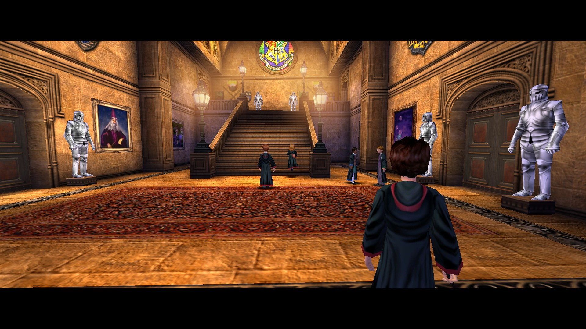
</p>

HPEngine is an unofficial, open-source replacement for the engine behind the first two Harry Potter games for PC by
KnowWonder / Electronic Arts, both built on Unreal Engine 1:

- **Harry Potter and the Philosopher's Stone / Sorcerer's Stone** (2001), "HP1" below;
- **Harry Potter and the Chamber of Secrets** (2002), "HP2" below.

It contains nothing of the games: it reads the maps, UnrealScript code, textures, sounds and music from a copy you own
and runs them on new code. Both games run on the same engine.

**A legally obtained copy of the game is required.** See [Requirements](#requirements).

## Status

Version: **beta (0.5.0)**.

| game | status |
|---|---|
| Harry Potter 1 (Philosopher's / Sorcerer's Stone) | **playable**: the full campaign was completed on 0.1.0 |
| Harry Potter 2 (Chamber of Secrets) | **first beta**, new in 0.5.0: it starts, plays and saves, but its campaign has not yet been played through to the end on HPEngine (see [Known issues](#known-issues)) |

Coming from 0.1.0? See [CHANGELOG.md](CHANGELOG.md) for how to move your saves.

## Quick start

1. **Download** the package for your system from [Releases](../../releases):
   - macOS (Apple Silicon and Intel): `HPEngine-Launcher-macOS.zip`
   - Windows: `HPEngine-win-x64.zip`
   - Linux / Steam Deck: `HPEngine-linux-x64.tar.gz`
2. **Add your game.** Start the launcher (macOS: HPEngine Launcher; Windows: `HPEngine Launcher.exe`; Linux: `HPEngine-Launcher`),
   pick the game's tab (**Harry Potter 1** or **Harry Potter 2**) and add your copy. The launcher never changes your
   files.
3. **Play.** Press **Play** (HP2: **New Game** or **Load Game**) in the launcher.

Step by step, with the first-launch warnings of macOS and Windows: [Install](#install).

## Contents

- [Highlights](#highlights) · [Screenshots](#screenshots) · [Improvements](#improvements-over-the-original-releases) · [Requirements](#requirements) · [Install](#install) · [Mods](#mods)
- [Known issues](#known-issues) · [Reporting a bug](#reporting-a-bug) · [FAQ](#faq) · [Contact](#contact) · [License](#license) · [Legal](#legal)
- More: [all differences from the original](docs/differences.md) · [settings](docs/settings.md) ·
  [building from source](docs/building.md) · [how the original engine works](docs/README.md) ·
  [code architecture](docs/architecture.md) · [contributing](docs/contributing.md)

## Highlights

- **Native, without a compatibility layer.** Built for Apple Silicon and Intel Macs, Windows x64 and Linux x64; no Wine, no
  virtual machine. The CD check and SafeDisc protection of the 2001 release are not involved, so modern Windows
  versions that refuse SafeDisc are no obstacle.
- **The games' own code, unchanged.** The shipped UnrealScript bytecode runs as it is in HPEngine's virtual machine; the
  engine's native functions are ported from the original binaries. Game logic, physics, timing, animation and saves
  behave as in the original release.
- **One engine for both games.** Code the two games share is written once; where Chamber of Secrets' engine differs from
  the first game's, HPEngine follows that game's own binaries.
- **Measured against the original.** Ported functions are run side by side with the original machine code in an
  emulator, frames are compared draw call by draw call with the running original game, and whole levels are played in
  both and their state compared. Every difference found so far has been fixed; please report any you notice.
- **Modern displays.** Any resolution and aspect ratio: on a wide screen you see more to the sides, the interface is
  scaled by whole pixels, and fast displays get up to 120 interpolated frames per second while the game logic keeps
  its native 60 Hz.
- **Easy setup.** A launcher on macOS, Windows and Linux installs the games, switches mods on and off, starts the game
  and keeps itself up to date. It works with the mouse, the keyboard or a gamepad.

## Screenshots

### Harry Potter and the Philosopher's Stone

<table>
  <tr>
    <td>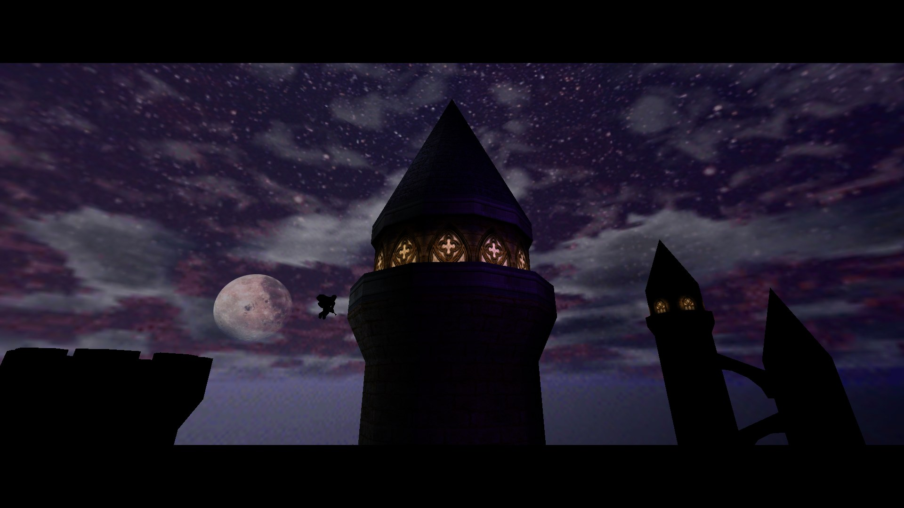</td>
    <td>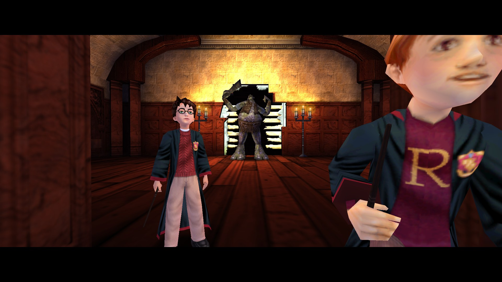</td>
  </tr>
  <tr>
    <td>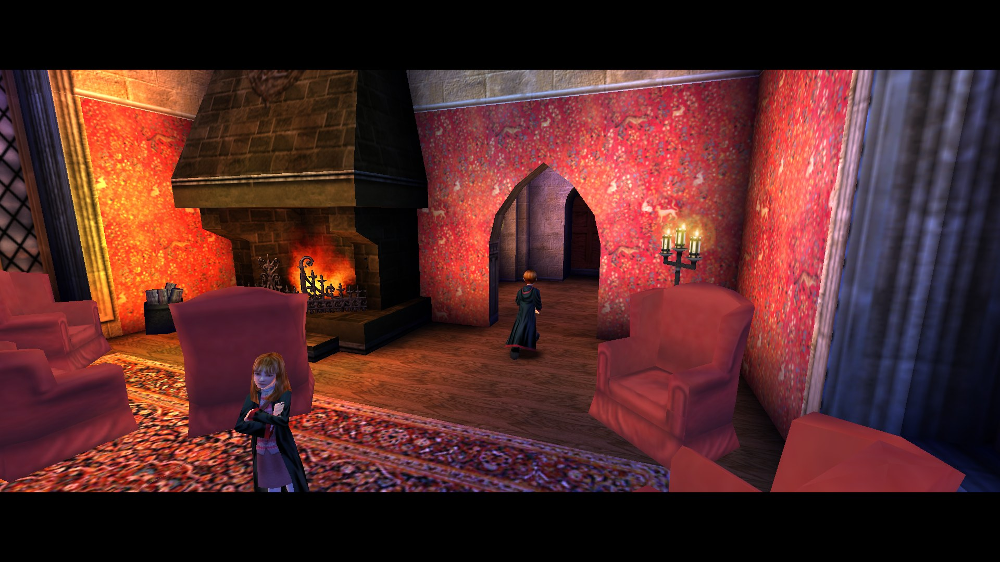</td>
    <td>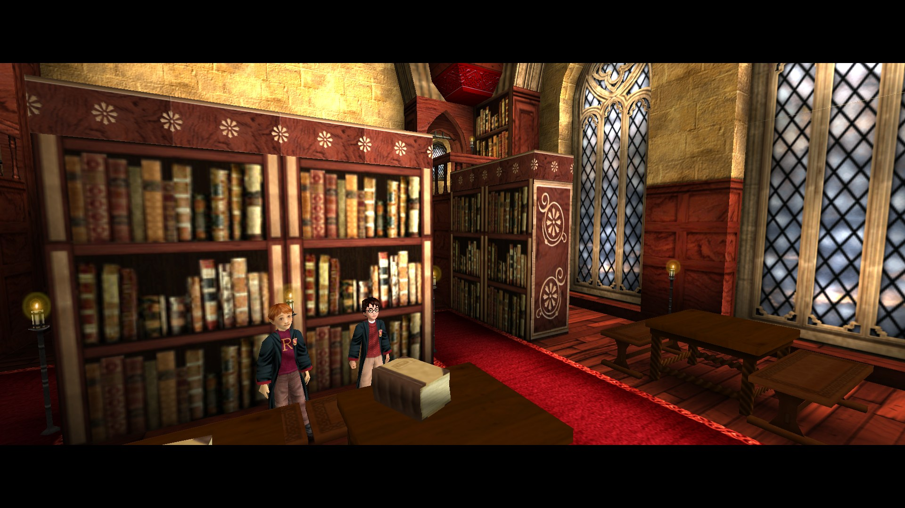</td>
  </tr>
  <tr>
    <td>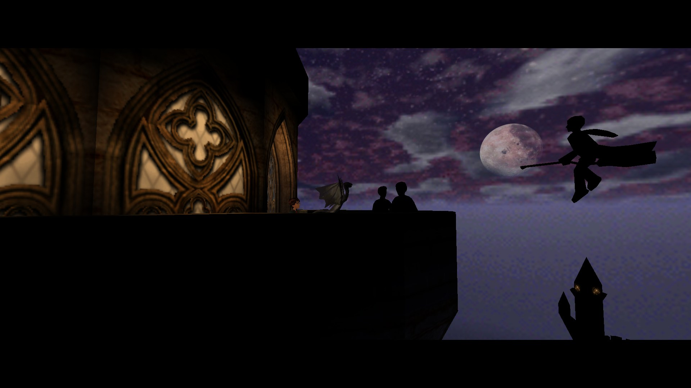</td>
    <td>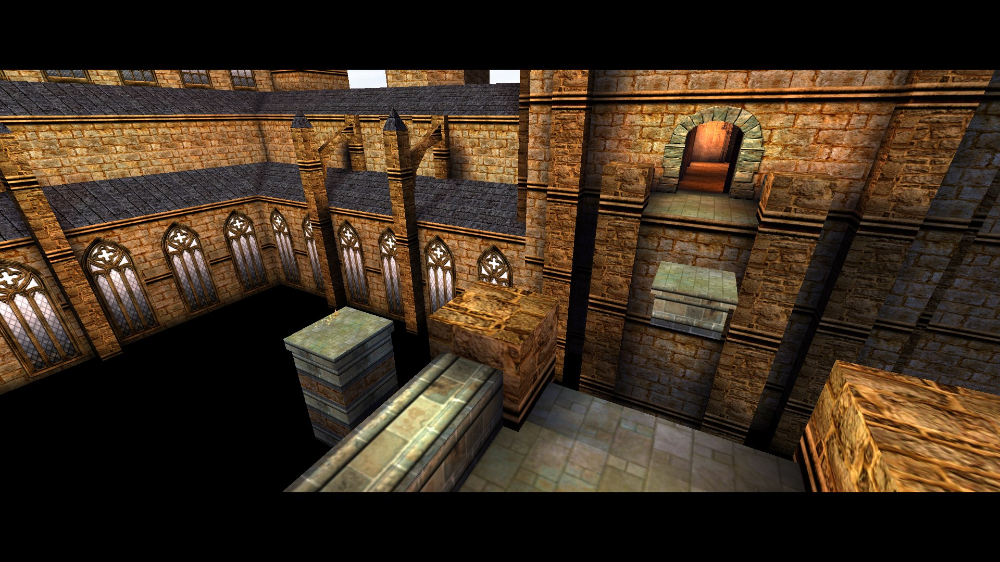</td>
  </tr>
  <tr>
    <td>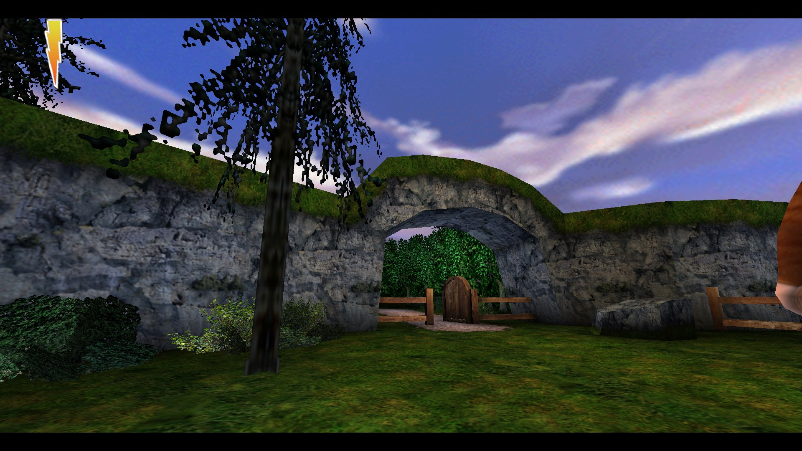</td>
    <td>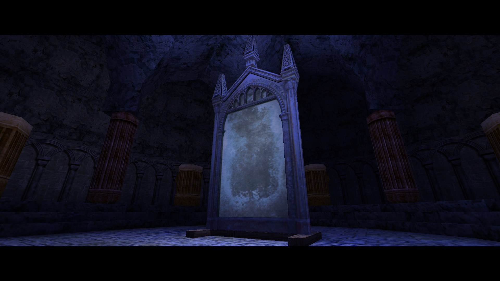</td>
  </tr>
</table>
<p align="center"><sub>HPEngine at 1920x1080 with the US 1.53 game files.</sub></p>

### Harry Potter and the Chamber of Secrets

<table>
  <tr>
    <td>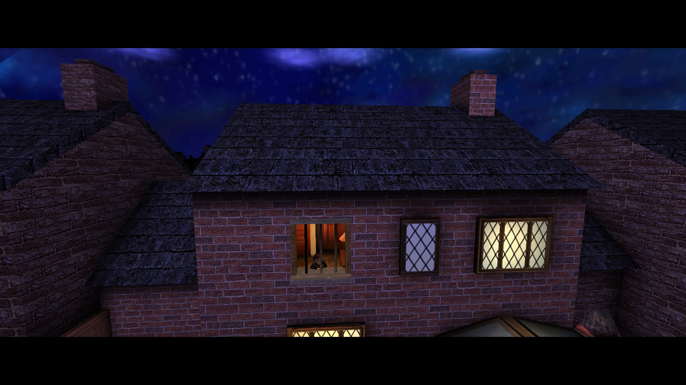</td>
    <td>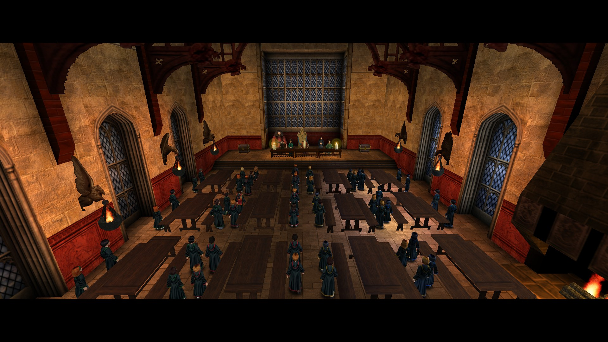</td>
  </tr>
  <tr>
    <td>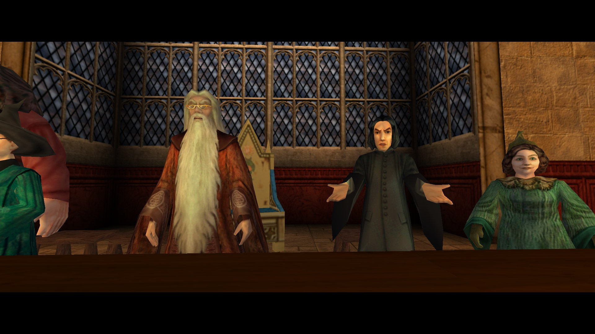</td>
    <td>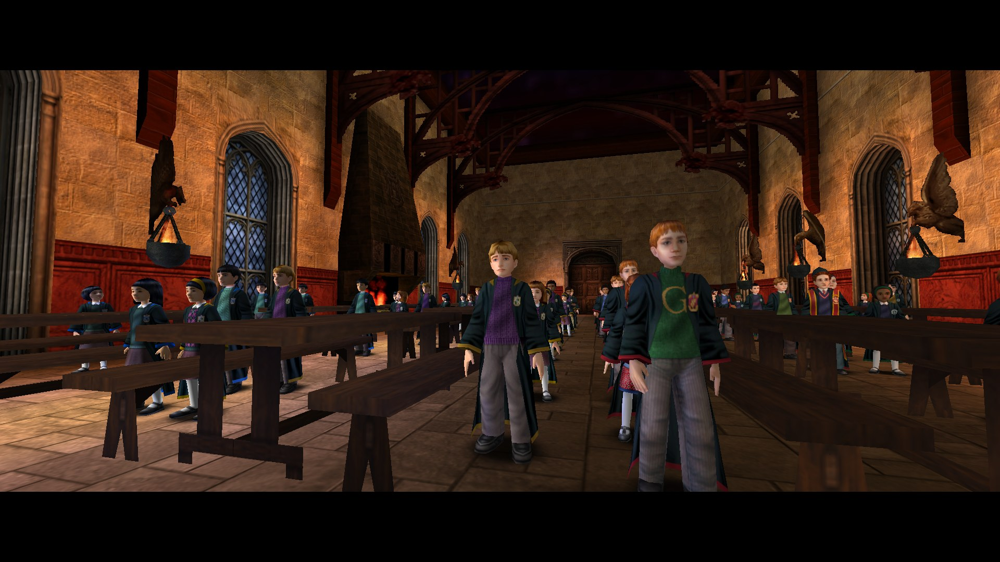</td>
  </tr>
  <tr>
    <td>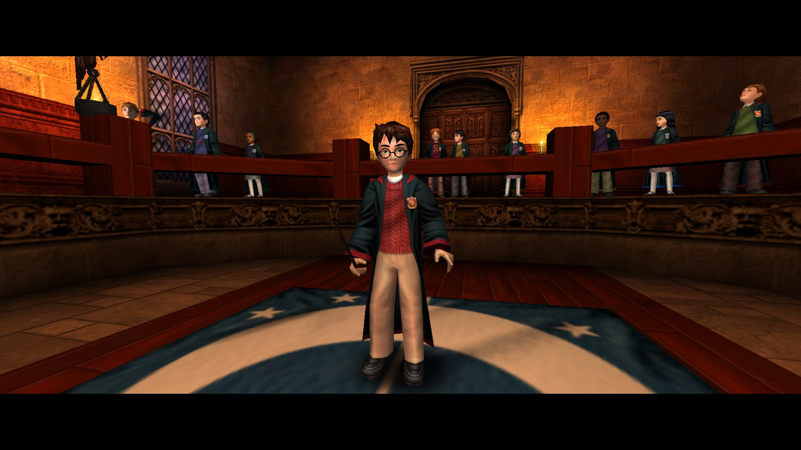</td>
    <td>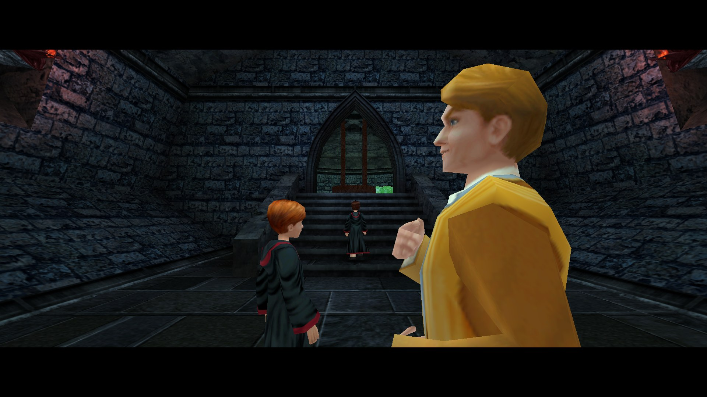</td>
  </tr>
  <tr>
    <td>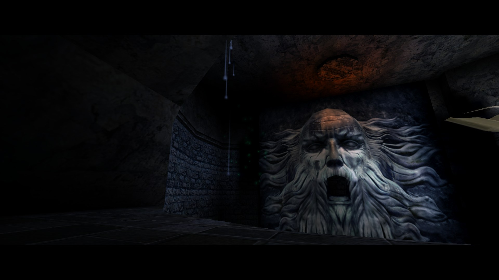</td>
    <td>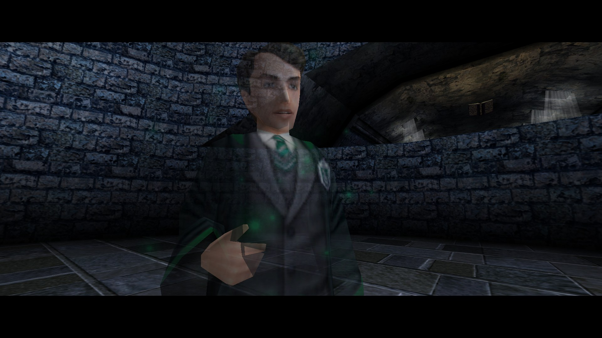</td>
  </tr>
</table>
<p align="center"><sub>HPEngine at 1920x1080 with the English retail game files.</sub></p>

## Improvements over the original releases

The games themselves are left as they were. Where HPEngine deliberately does something differently, it is listed here
and in detail, marked "not original", under [Differences from the original](docs/differences.md). They apply to both
games unless the list says otherwise:

- **Picture:** wide-screen view without stretching (menus and 2D screens stay 4:3), sharp interface at every size,
  smooth motion up to 120 fps, 16x anisotropic and trilinear filtering, models at full detail at any distance, no dark
  band on glasses, light flares hidden behind Harry instead of shining through him, Harry's robe not showing through
  his neck at high resolutions (HP1).
- **Timing:** the game logic is locked to 60 Hz, as its scripts assume; it never runs fast on high-refresh displays,
  and torch flames do not stop above 128 fps as they do in the original.
- **Sound:** mixed at 44.1 kHz (the original HP1 mixes at 22 kHz); music continues from the same place after Alt-Tab;
  in HP1 also after the pause menu, songs are no longer cut short and lowering the sound volume no longer silences the
  music.
- **Menus and input:** mouse-wheel scrolling in lists, an open list closes when the page changes, every resolution
  offered in every window mode, readable key names, the mouse is captured in a window without an extra click; gamepad
  support, with the controller's own button names on the Controls page and the d-pad stepping between menu controls,
  sliders and list items. Chamber of Secrets: B skips a cut-scene, Back opens the map, the d-pad picks the duel spell,
  and the options input page shows Difficulty for every player.
- **Bugs of the original fixed (HP1):** some Bertie Bott's beans flew away from Harry at a steady frame rate; Mrs Norris
  could not climb the library bookcases above about 30 fps.
- **Saves:** HPEngine's own save files stay loadable across HPEngine versions.

What we learned about how the original engine works, with addresses in the original binaries: [docs/](docs/README.md).

## Requirements

Your copy of the PC game, and one of the systems below.

### Harry Potter 1: tested editions

- **US English 1.53**: the reference; the port is checked against it.
- **UK English 1.1**: plays through.
- **Russian (EA)**: plays through; menu text in a substitute font (Philosopher for MS Sans Serif, **not original**).
- **Nordic multilingual CD** (`HARRY_POTTER_NORD_2210`: English, Danish, Finnish, Norwegian, Swedish): startup and
  localized menus on Windows 11; the campaign not yet.

Other releases (European English, French, German, Spanish, Italian, ...) and modified copies (the fan "1.55" patch,
modded re-releases such as the 2002 "City" disc) install and run with a warning: nobody has checked them yet.

HP1Setup detects the edition from the files and shows it. For a release it does not recognise it shows a warning
with the SHA-1 hashes of `System/HP.exe`, `Engine.dll`, `Render.dll` and `HPBase.u` (HPEngine prints the same warning
at start): please [open an issue](https://github.com/artemnikonov/hpengine/issues) with them and say whether the
game works. More: [docs/editions.md](docs/editions.md).

### Harry Potter 2: tested editions

- **English retail CD** (build HPCos_021009_1205-1): the release the port is built against.
- **Russian (EA "Hit-Parade")**: the same build and data as the English release, with its Russian dialogue and text.

Re-releases with changed game scripts install and run with a warning.

### Systems

| platform | status |
|---|---|
| macOS, Apple Silicon (M1 or later) | developed and played on; the package is not signed or notarized |
| macOS, Intel | the Launcher is universal; tested under Rosetta on Apple Silicon, **not yet on an Intel Mac** |
| Windows x64 (D3D12) | HP2: not yet tested. HP1: native startup, menus and five Nordic languages verified on Windows 11 Pro 26H2, OS build **26300.9818**; full campaign and save/load not yet verified on Windows. Earlier installs, play, save/load tests were under CrossOver (D3D12 translated) |
| Linux x64 / Steam Deck (Vulkan) | HP2: not yet tested. HP1 runs natively on the Steam Deck (no Proton); a full playthrough there is still to do |

## Install

You need your own copy of the game: see [Requirements](#requirements). HPEngine never changes it: it only reads it and
copies the game data into a folder of its own.

The launcher installs both games, each from its own tab, and each tab refuses the other game's copy:

- **Harry Potter 1** takes the CD, the game's installer, an installed game folder, a `.zip` of the game folder (and, on
  macOS, a disc image).
- **Harry Potter 2** takes the installed game folder or the English retail CD (its InstallShield setup is unpacked,
  never run: the English files are installed); then start a **New Game** or **Load Game** from the tab.

Pick your system. The launcher is the easy way; the last ways are for people who prefer the terminal.

### macOS (Apple Silicon and Intel)

1. Download `HPEngine-Launcher-macOS.zip` from [Releases](../../releases) and unpack it.
2. Move **HPEngine Launcher** to Applications and open it. It is not signed by Apple, so the first time macOS blocks
   it: open **System Settings → Privacy & Security** and click **Open Anyway**
   (or run `xattr -dr com.apple.quarantine "/Applications/HPEngine Launcher.app"`).
3. Pick the game's tab, drop your copy of the game onto the launcher window (or click **Choose…**), click **Install**,
   then **Play**.

The launcher keeps itself up to date and only installs updates signed by HPEngine.

### Windows

1. Download `HPEngine-win-x64.zip` from [Releases](../../releases) and unpack it into an **empty folder**. Inside are
   `HPEngine Launcher.exe`, `README.txt` and the folder `HPEngine\`; keep them together. No admin rights needed.
2. Run `HPEngine Launcher.exe`. The files are not signed: if SmartScreen warns, choose **More info → Run anyway**.
3. Pick the game's tab and drop your copy of the game onto the launcher window, or add it with **Choose folder…** (an
   installed game, or the CD drive) or **Choose files…** (HP1: the game's `Setup.exe` or a `.zip`); click
   **Install**, then **Play**. A disc image: double-click it to mount it, then add the new drive.

### Linux / Steam Deck

1. Download `HPEngine-linux-x64.tar.gz` from [Releases](../../releases) and unpack it into an empty folder
   (`tar -xzf HPEngine-linux-x64.tar.gz`, or **Extract** in the file manager). Inside are `HPEngine-Launcher`,
   `README.txt` and the folder `HPEngine/`; keep them together.
2. Run `HPEngine-Launcher` (double-click; if the file manager asks, choose **Execute**, or allow running it in the
   file's properties). Needs a Vulkan driver.
3. Pick the game's tab and add your game with **Choose folder…** or **Choose files…** (or drop it onto the window),
   click **Install**, then **Play**. A disc image: mount it first (Steam Deck: right-click in Dolphin → **Mount**),
   then add the mounted folder.

Steam Deck: in Desktop Mode, close Steam and choose **Menu → Add to Steam…** in the launcher (it keeps a backup of
Steam's shortcut list), or in Steam → **Add a Game → Add a Non-Steam Game…** → browse to `HPEngine-Launcher`. Then
start it from the Steam library (in Game Mode, and in Desktop Mode too). Started from Steam, the Deck's controls work
as a gamepad; started from a desktop shortcut, Steam keeps its desktop layout (trackpad as mouse, triggers as clicks)
until you hold the **≡** (Options) button.

The launcher keeps itself up to date on Windows and Linux too (signed updates only; the game data, saves and settings
are in your user folder and stay). A 0.2.0 launcher on Windows or Linux does not update itself: download and unpack
the new archive over it once.

### Without the launcher: Harry Potter 1 (Windows, Linux)

From the unpacked folder, in a terminal:

```sh
HPEngine/HP1Setup <game folder, CD, installer or .zip>   # checks the copy, copies the data into HPEngine/game/
HPEngine/HPEngine                                        # plays
```

(Windows: `HPEngine\HP1Setup.exe`, `HPEngine\HPEngine.exe`.) A game installer (Inno Setup `Setup.exe` with its `.bin`
files, or InstallShield `data1.cab`) is unpacked, never run. HP1Setup prints the edition it found and refuses to write
into a folder that holds a game it did not install.

### Without the launcher: Harry Potter 2

```sh
HPEngine/HP1Setup --game hp2 --dest <folder> <game folder or CD>
HPEngine/HPEngine --root <folder>
```

### Manually, into your game folder: Harry Potter 1 (all systems)

If you already have the game installed (or its installed folder copied from a Windows PC), HPEngine can run it in
place. The **game folder** is the one with `System/` and `Maps/`.

1. Download the archive for your system from [Releases](../../releases): `HPEngine-win-x64.zip`,
   `HPEngine-linux-x64.tar.gz`, or for macOS `HPEngine-osx-arm64.tar.gz` (Intel Mac: `HPEngine-osx-x64.tar.gz`).
2. Unpack it **into the game folder**. Nothing in it overwrites a game file.
3. Run it:
   - Windows: `HPEngine Launcher.exe` (unpacked into a game folder it works with that game: nothing is installed and
     it never removes your folder), or `HPEngine\HPEngine.exe` directly.
   - Linux / Steam Deck: `./HPEngine-Launcher`, or `./HPEngine/HPEngine`. On a case-sensitive file system keep the
     original file names exactly (`System`, `Maps`, `Lev_Tut1.unr`, ...).
   - macOS: this archive has no launcher and no wrapper folder: `tar -C <game folder> -xzf HPEngine-osx-arm64.tar.gz`,
     then `xattr -dr com.apple.quarantine <game folder>` and run `./HPEngine` from Terminal.

The engine also takes the game folder as `--root <game folder>`. If the game is not found, HPEngine shows what is
missing and exits with code 4.

### Where things are

| | macOS | Windows | Linux / Steam Deck |
|---|---|---|---|
| HP1 game folder (launcher) | `~/Library/Application Support/HPEngine/game` | `%LOCALAPPDATA%\HPEngine\game` | `~/.local/share/HPEngine/game` |
| HP1 saves | `<game folder>/Save/` | same | same |
| HP1 settings and logs | `<game folder>/HPEngineData/` (logs in `logs/`) | same | same |
| HP1 mods | `<game folder>/Mods/` | same | same |
| HP2 mods | `HP2Data/game/Mods/` (list: `HP2Data/HPEngineData/Mods.ini`) | same | same |
| HP2 (launcher) | `~/Library/Application Support/HPEngine/HP2Data/` | `%LOCALAPPDATA%\HPEngine\HP2Data\` | `~/.local/share/HPEngine/HP2Data/` |

Harry Potter 2 is installed into `HP2Data/game` beside the first game's folder; its saves and settings are in
`HP2Data/Save` and `HP2Data/HPEngineData`, kept when you install again or remove the game (unless you ask to delete
them too).

Without the launcher the HP1 game folder is `HPEngine/game/` (HP1Setup) or your own game folder (manual install). The
launcher's **Menu** opens the saves and the logs folder (**This game**). The shipped `.ini` files are never rewritten. Saves are in
HPEngine's own format: they stay loadable across HPEngine versions, but saves of the original games are not read.

### Game language

The launcher's **Language** row lists the languages included in your game files (it is shown only when there is
more than one). Select one before pressing
**Play**; the choice is remembered. For multilingual discs, the language is read from each numbered `System` folder's
`Default.ini`, rather than assuming folder `0` is the language you want. The corresponding text, dialogue, menu art
and splash are used together. **Game default** restores the original data selection.

No language files are downloaded. If your copy contains only one language, you need your own game data containing
another language to use it. Original files stay unchanged: the engine builds a working copy (links where available) in
`HPEngineData/modroot`, and applies enabled mods after the selected language. As in the original game, a package with
the language's suffix (such as `AllDialog.fin_uax`) is opened before the plain one (`AllDialog.uax`). Saves stay in the
normal `Save` folder; selecting a language does not change the list of script mods recorded in saves. Removing a
selected language is reported as an error until you select an available language or **Game default**.

The launcher separates multilingual data from its engine family. For example, the Nordic language set shares the
engine family called **UK 1.1**; that match does not identify a UK disc. **Different data** means the Nordic files
differ from that family's reference manifest, which alone does not establish that a disc was modified. The language
set is detected from installed files; identifying an exact source image requires its volume information and hashes.

## Controls and settings

Keyboard and mouse work as in the original (rebind keys in **Options → Controls**); **Alt+Enter** toggles fullscreen.
A gamepad works out of the box (not original): left stick moves, right stick looks, A jumps, X or the right trigger
casts, B skips, Start opens the book; **Options → Controls** shows and rebinds the gamepad's buttons while you use it.
Chamber of Secrets differs: A also does the broom action, B skips a cut-scene, **Back / View** opens the map, the d-pad
picks the duel spell; its Controls page shows the gamepad but cannot rebind yet.
HP1: any key skips the start-up splash screens, and Space turns a story-book page once it has been shown for 2 seconds (not
original: the original allows both only in its hidden debug mode, and never from a story's first page).
The full layout, interface size, the original-look mode and the other HPEngine settings:
[docs/settings.md](docs/settings.md).

## Mods

Existing mods can be switched on and off without changing your game copy, for both games in the same way. Each game
tab has a **Mods** row that opens its Mods page:

1. **Add Mod…** (or drop the mod onto the Mods page) takes the mod's folder, its `.zip`, `.7z` or `.rar` archive, or a
   single game file such as a map (`.unr`). The launcher copies it into `Mods/<mod name>/` in that game's folder; one
   wrapper folder around the mod (as in `Mod-v1.zip/Mod-v1/System/...`) is dropped. A mod's installer (`.exe`) is
   never run: unpack the mod first. You can also put the files into the folder yourself (**Open Mods Folder**). Loose
   packages such as `HPBase.u` are fine: each file goes where the game itself looks for that kind of file.
2. Switch the mod on (or add `Enabled=<mod name>` under `[Mods]` in `Mods.ini`; see [Where things are](#where-things-are)).
   When two mods change the same file, the launcher numbers the enabled mods in apply order and the higher number wins;
   the Mods page names two enabled mods with the same file. **×** on a mod's row removes it (to the Trash / Recycle Bin).

A mod that adds its own maps: choose the map in **Start map** next to **Play** (without the launcher:
`--map <map name>`).

Your saved games stay in the same place with or without mods. A save made with a different set of script mods
restarts its level from the beginning, with the progress you had when you entered it; the game says so at the top of
the screen. A save made by 0.1.0 loads only with the mods off.

This is a beta: a mod may not work. Small mods (changed scripts, textures, translations, single maps) are the ones to
expect to work. Checked on 0.3.0: every map of 11 popular mods, including Restored + Free Play, loads, except two maps
named `Entry` (they have no player start; the original stops on them too) and Sofas and Armchairs, which needs a class
from Harry Potter 2. Mods made for the fan 1.55 may misbehave on 1.53. If a mod fails, the launcher shows the reason:
please report it with the mod's name. Check any other bug without mods before reporting it.

Chamber of Secrets: the mods published so far (maps, cutscene and script mods) are made for Metallicafan212's later HP2
engine and editor; their packages have a newer format than the retail game's, and HPEngine cannot open them yet. The
Mods page says so under such a mod, and Play refuses while it is on. A mod for the retail game is expected to load.

## Known issues

Both games:

- macOS and Windows builds are not signed: Gatekeeper and SmartScreen warn on first launch.
- No `.app` bundle in the manual archive on macOS; run from Terminal or use the launcher.
- Please report anything that differs from the original: see [Reporting a bug](#reporting-a-bug).

Harry Potter 1:

- Native Windows startup and localized menus were tested on Windows 11 Pro 26H2 (OS build 26300.9818) with the Nordic
  multilingual CD. A full campaign and save/load on Windows still need verification; earlier tests were under CrossOver.
- Mods are in beta: a mod not listed in [Mods](#mods) has not been checked and may not work.
- UK 1.1 and Russian: they play through, but are not yet proven exact against those builds. Russian menu text uses a substitute font
  (not original). Other releases (European English and the other languages) are unverified: they install and run with
  a warning, and nobody has checked them yet. Modified copies (patches, mods, modded re-releases) also install and run
  with a warning; please check a bug with the unmodified game before reporting it.

Harry Potter 2 (first beta):

- Its campaign has not yet been played through to the end on HPEngine; please report anything that stops you.
- Rebinding keys or buttons on its Controls page is not available yet.
- Mods made for Metallicafan212's HP2 engine (all published HP2 map and script mods checked) do not load yet: see [Mods](#mods).

## Reporting a bug

Please [open an issue](../../issues/new/choose). What helps most:

- **Game, edition and platform:** which game and which copy of it (HP1Setup, the launcher and the first lines of the
  log name it) and which system and display you play on.
- **Where and what:** the map or the place in the story, what you did, what happened and what you expected. If you
  can compare with the original game, say how it behaves there.
- **The log** of that session: the newest `run_<date>_<time>.log` in the game's `HPEngineData/logs/` (HP1:
  `<game folder>/HPEngineData/logs/`, HP2: `HP2Data/HPEngineData/logs/`; the launcher: **Menu → Open logs folder**).
  It names files on your computer, so it may contain your user name; remove it if you prefer.
- **A save** close to the problem, if there is one: HP1 `save<N>.hp1sav` and `GameSaveInfo<N>` from
  `<game folder>/Save/`; HP2 the files in `HP2Data/Save/`.

## FAQ

**Where do I get the games?** HPEngine needs the original PC release: the CD or a copy you installed from it. The
games are not sold digitally.

**Do my saves from the original games work?** No. HPEngine has its own save format, so start a new game; its saves stay
loadable in later HPEngine versions.

**Can I see the game exactly as it looked in 2001?** Set `VisualMode=Original` in the `[HPEngine]` section of
`<game folder>/HPEngineData/Default.ini`; the 3D world is then drawn as the 2001 renderer drew it. See
[docs/settings.md](docs/settings.md).

**Is Chamber of Secrets finished?** It is a first beta: it starts, plays and saves on the same engine, but its campaign
has not yet been played through to the end on HPEngine. Install it from the launcher's **Harry Potter 2** tab (see
[Install](#install)).

**Does it run on Intel Macs?** Yes, the macOS Launcher is universal. It has been tested under Rosetta on Apple Silicon,
not yet on an Intel Mac; reports are welcome.

**Steam Deck?** The Linux package runs natively on the Deck, without Proton, and the Deck's controls work as a
gamepad. For Game Mode add `HPEngine-Launcher` in Desktop Mode: Steam → **Add a Game → Add a Non-Steam Game**. A full
playthrough there is still to do.

**Is this legal?** HPEngine contains no code, data or assets of the original games; it runs a copy you own. See
[Legal](#legal).

## Contact

- Bugs: [Issues](../../issues) (see [Reporting a bug](#reporting-a-bug)).
- Questions, ideas, help with setup: [Discussions](../../discussions).

## Credits

- HPEngine: Artem Nikonov.
- Original games: KnowWonder, published by Electronic Arts; Unreal Engine 1 by Epic Games.
- Third-party components (SDL3, SDL3-CS, UELib, the .NET runtime, innoextract, unshield, Philosopher):
  [THIRD_PARTY_NOTICES.md](THIRD_PARTY_NOTICES.md).

## License

The HPEngine source code is released under the GNU General Public License, version 3 or later (see `LICENSE`):
you may use, change and share it, and what you distribute must stay open under the same license.
Copyright (C) 2026 Artem Nikonov and HPEngine contributors. The license covers the port's code only and
grants no rights to the original games or their files. Third-party components keep their own licenses
(THIRD_PARTY_NOTICES.md).

## Legal

HPEngine is a fan project. It is not affiliated with, endorsed by or sponsored by Warner Bros. Entertainment, Wizarding
World Digital, Electronic Arts, KnowWonder, Epic Games or J.K. Rowling. Harry Potter names and marks are trademarks of
their owners. This repository contains no game assets, code or data of the original games; you need your own copy of
the game to use it. Do not open issues asking for game files.
